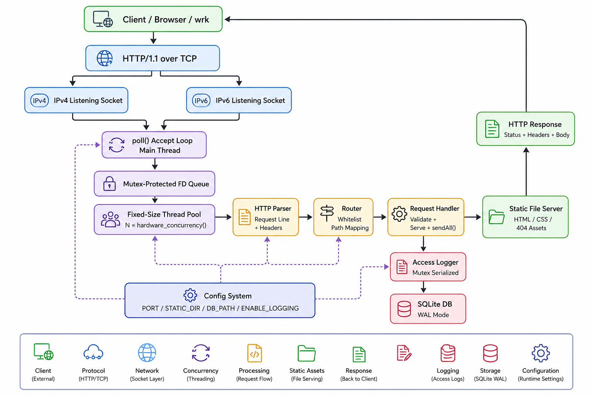
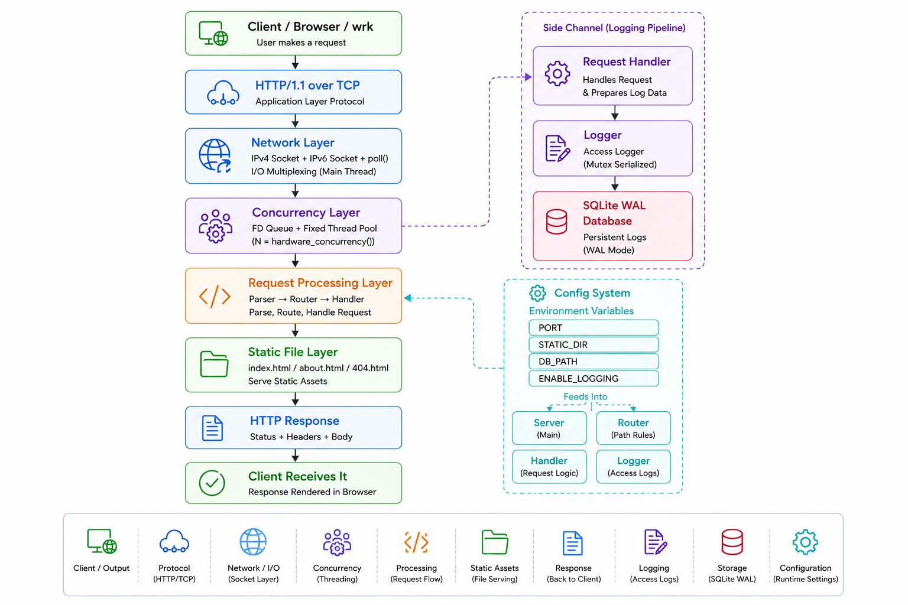
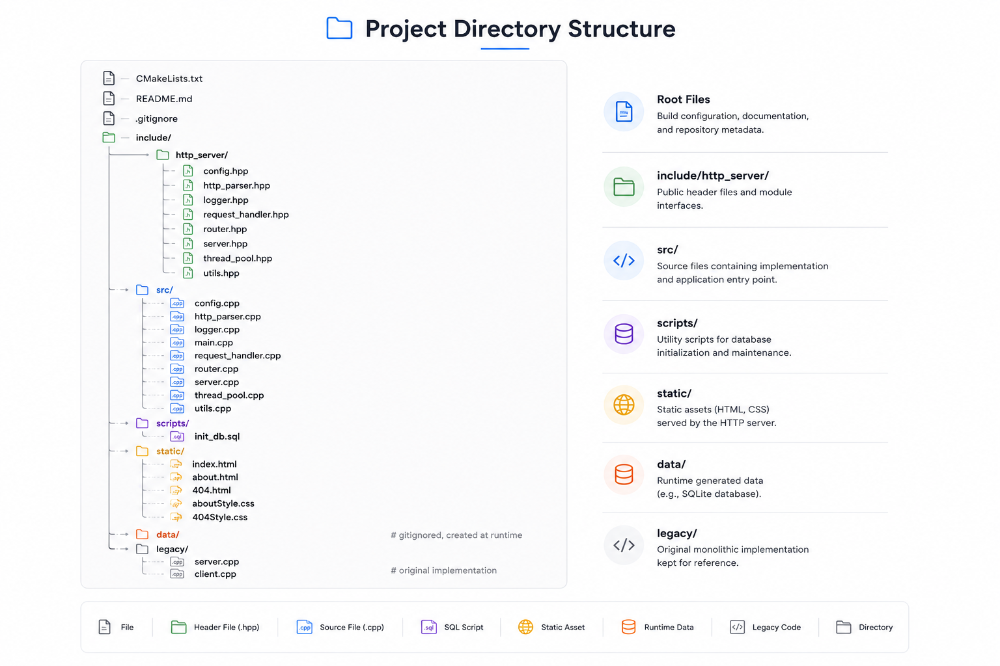

# http-server

A blazingly fast, event-driven **HTTP/1.1 server** built entirely from scratch in modern **C++17**. No bulky frameworks—just raw performance, clean architecture, and embedded SQLite logging.

| ~180k req/sec, p99 0.59 ms (keep-alive, one thread) | HTTP/1.1 keep-alive + ordered pipelining | Dual-Stack IPv4 / IPv6 |
| :---: | :---: | :---: |

### Why I Built This :-

This project started as a raw "learn-by-building" monolith (preserved in `legacy/`). It was refactored into eight modules with a thread pool, then rebuilt around a single-threaded event loop with keep-alive, bounded resources, and asynchronous logging. The full story is in [Project history](#project-history).

---

## Quick Links
* [Highlights](#highlights)
* [Architecture](#architecture--blueprints)
* [Getting Started](#spin-it-up-in-60-seconds)
* [Configuration](#configuration)
* [Performance](#performance)
* [Project history](#project-history)

---

## Highlights

* **~180,000 requests/sec** median over three 60-second runs, p99 0.59 ms, zero errors across 32 million requests (keep-alive, logging off, one event-loop thread, Apple M1, load generator on the same machine).
* **Event-loop connection handling** — one `poll()`-driven thread manages many admitted sockets without a per-connection blocking worker.
* **HTTP/1.1 keep-alive and HTTP/1.0 persistence** — explicit `Connection` handling, buffered incremental parsing, and ordered pipelined responses with bounded queues and read backpressure.
* **Zero external runtime dependencies** beyond `libsqlite3` and the C++ standard library.
* **Dual-stack networking** — separate IPv4 and IPv6 listening sockets, multiplexed via `poll()`.
* **Bounded asynchronous SQLite logging** — one writer thread owns the connection, batches transactions, and drops newest records visibly if the bounded queue fills.
* **Graceful shutdown** via `SIGINT`/`SIGTERM` signal handlers and an atomic running flag.
* **Toggleable logging** — flip access logging on or off via an environment variable, no recompilation required.

---

## Architecture & Blueprints

### 1. High-Level Blueprint
The event loop owns the IPv4/IPv6 listening sockets and all admitted connections. Readiness drives partial reads and writes; buffered requests and ordered response queues provide keep-alive and pipelining without a blocking worker handoff.



### 2. The Internal Pipeline
A deep-dive look at the event loop, per-connection request/response buffers, and the asynchronous logging writer.



### 3. Clean Project Layout
Designed to map cleanly to modern CMake standards with a strict separation of concerns.



---

## Deep-Dive Engineering Details

<details>
<summary><b> Click to view core design choices & optimizations</b></summary>

* **The event loop** uses `poll()` with a bounded timeout, rebuilds readiness registrations from owned connection state, and subscribes to writable readiness only while a response is pending.
* **Per-connection state** owns the descriptor, admission permit, cancellation registration, absolute header/write/idle deadlines, bounded input, a bounded FIFO of pending responses, and shared cached-body references. One owner closes each descriptor.
* **Keep-alive and pipelining** — `parseRequestFromBuffer()` consumes exactly one request, retained bytes feed the next request, and responses are written FIFO. Reading pauses when the pending-response or input-buffer bound is reached.
* **Fairness and bounds** — accepts are capped per iteration, each ready connection gets bounded read/write and parse work, input and pending responses are bounded, and writable readiness is requested only while output is pending.
* **Off-loop work** — static files are preloaded at startup and SQLite runs only on the async logging writer; the event loop only enqueues copied log records.
* **Logging** is copied into a bounded queue and handled by one dedicated writer thread; queue overflow is best-effort and surfaced through metrics.
* **CMake layout** maps cleanly to expectations: a single `file(GLOB ...)` over `src/*.cpp` picks up every translation unit, and `target_include_directories(... include)` makes all module headers resolvable as `#include "http_server/<module>.hpp"`.

</details>

<details>
<summary><b> Click to view Module Responsibilities</b></summary>

| Module | Responsibility |
|---|---|
| **`config`** | Loads runtime, limit, timeout, cache, and asynchronous logging settings from environment variables with validation. |
| **`http_parser`** | Parses the HTTP request line and headers into a structured `ParsedRequest`. Returns `valid = false` on malformed input. |
| **`router`** | Maps HTTP paths to file paths under the static directory. Whitelist-based; unknown routes fall back to the 404 page. |
| **`request_handler`** | Legacy synchronous handler retained for compatibility tests; the active server uses the event-loop path. |
| **`thread_pool`** | Legacy fixed-size worker pool retained for unit coverage; not used by the event-loop server. |
| **`logger`** | Bounded asynchronous SQLite writer. Owns schema v1, batches explicit transactions, records transfer outcomes and accepted bytes, retries bounded failures, and exposes queue/drop/commit metrics. |
| **`server`** | Owns the listening sockets, dual-stack setup, the `poll()` event loop, persistent-connection state, pipelined response ordering, deadlines, admission, and shutdown. |
| **`utils`** | Small standalone helpers: `trim()`, `getContentType()`. |

</details>

---

## Spin It Up in 60 Seconds

### 1. Install dependencies

```bash
# macOS
brew install cmake sqlite pkg-config

# Ubuntu / Debian
sudo apt install build-essential cmake libsqlite3-dev pkg-config
```

### 2. Build

```bash
cmake -S . -B build
cmake --build build -j
```

### 3. Run

```bash
mkdir -p data
./build/bin/http_server
```

Run the test suite (14 tests, C++ unit and Python integration):

```bash
cd build && ctest --output-on-failure
```

Open the server:

```bash
curl -i http://localhost:8080/
```

Or visit:

```text
http://localhost:8080/
```

---

## Configuration

Runtime settings are provided through environment variables..

| Variable | Default | Purpose |
|---|---:|---|
| `PORT` | `8080` | Server port |
| `STATIC_DIR` | `static` | Static file directory |
| `DB_PATH` | `data/logs.db` | SQLite log database, used only when logging is enabled |
| `ENABLE_LOGGING` | `true` | Enable SQLite access logging; `false` does not open SQLite |
| `MAX_CONNECTIONS` | `1024` | Maximum admitted event-loop connections |
| `MAX_QUEUED_CONNECTIONS` | `256` | Legacy/no-op; the event-loop server has no worker queue |
| `WORKER_THREADS` | `0` | Legacy/no-op; the server uses one event-loop thread |
| `KEEPALIVE_TIMEOUT_MS` | `5000` | Idle timeout while waiting for the next request on a persistent connection |
| `MAX_REQUESTS_PER_CONNECTION` | `1000` | Maximum requests accepted per connection |
| `MAX_PIPELINED_REQUESTS` | `8` | Maximum queued responses per connection; reading pauses at this bound |
| `MAX_CONNECTION_INPUT_BYTES` | `131072` | Maximum buffered request bytes per connection |
| `RECV_TIMEOUT_MS` | `5000` | Deprecated/no-op; readiness replaces per-operation blocking waits |
| `SEND_TIMEOUT_MS` | `5000` | Deprecated/no-op; absolute response write deadlines remain authoritative |
| `HEADER_TIMEOUT_MS` | `10000` | Absolute time allowed to receive one request's headers, in milliseconds |
| `WRITE_TIMEOUT_MS` | `10000` | Absolute time allowed to write one response, in milliseconds |
| `SHUTDOWN_GRACE_MS` | `5000` | One global grace period for active socket work during shutdown, in milliseconds |
| `MAX_ASSET_BYTES` | `16777216` | Maximum size of one preloaded static asset, in bytes |
| `MAX_ASSET_CACHE_BYTES` | `67108864` | Maximum total bytes of unique preloaded asset bodies |
| `LOG_QUEUE_CAPACITY` | `8192` | Maximum queued log records |
| `LOG_BATCH_SIZE` | `256` | Maximum records per SQLite transaction |
| `LOG_FLUSH_INTERVAL_MS` | `10` | Maximum wait to accumulate a low-traffic batch |
| `LOG_MAX_RETRIES` | `2` | Bounded retries for a failed batch |
| `LOG_RETRY_BACKOFF_MS` | `10` | Delay between batch retries |
| `LOG_SHUTDOWN_DRAIN_MS` | `2000` | Maximum shutdown drain period for queued records |
| `DIAGNOSTICS_INTERVAL_MS` | `0` | Periodic aggregate server/logger diagnostics; `0` disables |

Example:

```bash
PORT=9000 ENABLE_LOGGING=false ./build/bin/http_server
```

Connections beyond `MAX_CONNECTIONS` receive a best-effort
`503 Service Unavailable` and are closed. Each admitted descriptor is owned by
exactly one per-connection state and is closed when the connection is finished
or rejected.

The first request's header deadline starts at connection acceptance; on a
persistent connection, idle waiting uses `KEEPALIVE_TIMEOUT_MS`, and the next
header deadline starts when that request begins. Trickled bytes never reset an
active header deadline. Each queued response has its own absolute write
deadline from when it is queued, so a slow reader cannot extend it.
A header timeout queues one `408 Request Timeout` and closes; write timeouts
close the connection because a partial response may already have been sent.

HTTP/1.1 connections are persistent unless the request carries
`Connection: close`; HTTP/1.0 persistence requires an explicit
`Connection: keep-alive`. Responses carry the matching connection header.
Pipelined requests are answered in FIFO order and bounded by
`MAX_PIPELINED_REQUESTS`; reading pauses while that queue is full. A request
that requires close discards all later buffered bytes. Ambiguous framing and
request bodies are rejected without interpreting body bytes as another
request. No upgrade or protocol switching is performed.

Allowlisted static responses are preloaded once at startup into an immutable
cache. Bodies are shared between requests, status/MIME/header metadata are
reused, and lookups are read-only without a global mutex. Missing allowlisted
files serve the 404 fallback; if the fallback file is also missing, an inline
404 body is used. An asset larger than `MAX_ASSET_BYTES`, or unique bodies
exceeding `MAX_ASSET_CACHE_BYTES`, fail startup with a diagnostic. Cached
content changes require a restart.

Access-log schema version 1 records the intended HTTP status separately from
`transfer_outcome`. Outcomes are `complete`, `partial`, `disconnected`,
`timeout`, `shutdown_cancelled`, `failed`, or `unknown` for historical rows.
`bytes_sent` counts response bytes accepted by successful `send()` calls,
including partial sends; it is not proof of delivery to the client. Existing
databases are migrated in place and historical rows keep `unknown`.

Access logging is asynchronous and best-effort and records each response, not
one record per connection. The event loop copies bounded records into a bounded
queue; one writer thread owns SQLite and flushes batches
in explicit transactions. When the queue is full, the newest record is dropped
and counted. The writer reports offered, accepted, committed, failed, dropped,
discarded, queued, peak-queue, in-flight, batch, and flush-latency metrics at
shutdown. Records still queued or in flight when the process crashes are lost.
Committed records use SQLite WAL with `synchronous=NORMAL`, so an OS crash or
power loss can also lose recent committed transactions. There is no retention,
rotation, partitioning, or aggregation: at 100k requests/sec, one row per
request is 8.64 billion rows/day, so disk growth and retention must be handled
outside this server.

Request-log schema initialization uses an embedded schema, not a file path
relative to the working directory. With `ENABLE_LOGGING=false`, the server does
not require a writable database directory, does not open SQLite, and does not
create database, WAL, or shared-memory files. Startup database failures print a
diagnostic and exit nonzero: socket setup failures return 1, and SQLite or
other initialization failures return 2. Invalid environment values retain the
existing warning-and-default behavior.

Shutdown stops accepting, closes idle connections immediately, and gives
connections with pending responses one global `SHUTDOWN_GRACE_MS` period. At
grace expiry it cancels remaining registrations, logs each unsent response as
`shutdown_cancelled`, and closes the event-loop owners. At logger shutdown, producers have
already stopped; queued records are drained until `LOG_SHUTDOWN_DRAIN_MS`, then
discarded and counted. A SQLite call or writer-thread join can still exceed the
drain period, so shutdown is not a strict whole-process bound.

---

## Routes

| Path | Response |
|---|---|
| `/` | Home page |
| `/about` | About page |
| Unknown path | Custom 404 page |

Only `GET` requests are supported.

---

## Performance

Measured on 26 October 2026: Apple M1 (8 cores), macOS, Release build, loopback, `wrk` with 1 thread and 100 connections on the same laptop, `GET /` with a 1,277-byte body. Three 60-second runs per mode, each against a fresh server after a 5-second warm-up. Raw results are in [`data/benchmarks/v2-baseline/`](data/benchmarks/v2-baseline/).

| Mode | Median req/sec | Range | p50 | p99 |
|---|---:|---:|---:|---:|
| Keep-alive, logging off | **179,853** | 179,850 to 180,344 | 0.396 ms | 0.591 ms |
| Keep-alive, SQLite logging on | **168,544** | 167,931 to 170,698 | 0.391 ms | 0.742 ms |
| Connection-per-request, logging off | ~21,000 | 20,609 to 21,456 | 1.76 ms | ~290 ms |

* **The big number comes from keep-alive.** Opening a new TCP connection per request costs more than serving the page, so connection-per-request stays around 21k, the same as the v1 thread-pool server. Reusing connections is what gives 8x.
* **Both sides were saturated.** The server's event loop and the `wrk` thread each used about 100% of one core, so ~180k is the ceiling of this one-laptop setup, not of the server alone.
* **Logging costs about 6%.** The SQLite writer runs on its own thread and commits about 171,000 rows/sec. Above that its bounded queue fills and records are dropped and counted (0 to 3.2% per run). Logging-on throughput is not lossless logging throughput.
* **Connection-per-request has a ~290 ms p99 tail.** Kernel counters during those runs show TCP retransmit timeouts and packets dropped for low memory under ~20,000 new connections/sec, so the tail most likely comes from the OS rather than the server. Details in the [v2 write-up](docs/README_V2_EVENT_LOOP.md#open-problems).

---

## Project history

* [v1: from one file to eight modules](docs/README_V1_MVP.md): the `legacy/` monolith, its bugs, and the modular thread-pool refactor.
* [v2: thread pool out, event loop in](docs/README_V2_EVENT_LOOP.md): the event-loop rewrite, the benchmarks, and the open problems.
* [v3 plan](docs/V3_PLAN.md): what comes next.

---

## Roadmap

The next version targets per-request cost first, then more than one core. Full plan in [docs/V3_PLAN.md](docs/V3_PLAN.md).

- Parse each request once over `string_view`, with no per-request heap allocation
- Pre-built responses sent with one `writev()`
- `kqueue` / `epoll` instead of `poll()`, and a timer wheel for deadlines
- Several event loops in one process, fed by one acceptor thread
- Lock-free per-loop log rings so logging keeps up without drops
- Docker support

---
